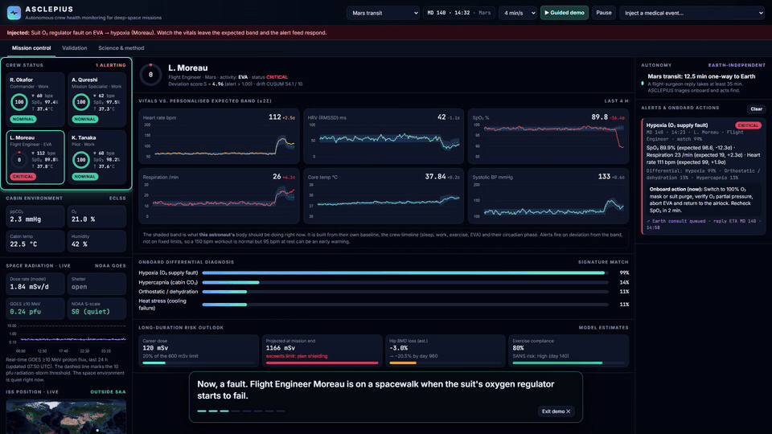
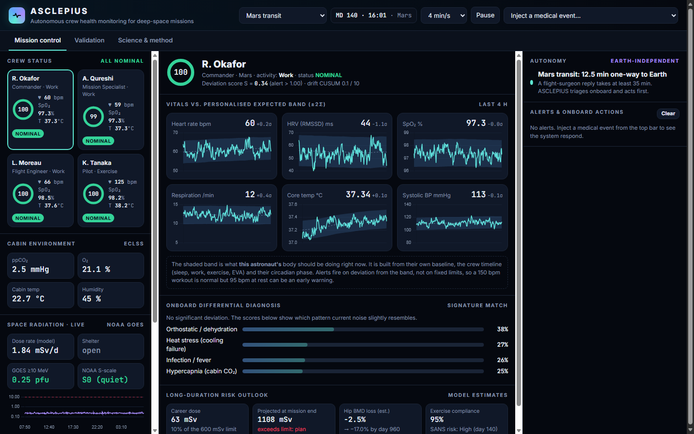

# ASCLEPIUS: Autonomous Crew Health Monitoring for Deep-Space Missions

> **NASA Space Apps Challenge 2026**
> **Challenge:** *Create Health Monitoring Software for Astronauts on Space Missions*

### 🔗 [**Live app**](https://asclepius-crew-health.vercel.app) · [**Pitch deck**](https://asclepius-crew-health.vercel.app/pitch.html) ([PDF](docs/ASCLEPIUS-pitch.pdf) · [PPTX](docs/ASCLEPIUS-pitch.pptx)) · [**60-s video**](https://asclepius-crew-health.vercel.app/docs/asclepius-60s.mp4) · [**30-s video**](https://asclepius-crew-health.vercel.app/docs/asclepius-30s.mp4) · [**Full demo**](https://asclepius-crew-health.vercel.app/docs/asclepius-demo.mp4)

[](docs/asclepius-demo.mp4)

*Click the animation for the full narrated demo (about 1.5 min). In the live app, press **▶ Guided demo** for the same tour.*

## 🎬 Videos

| Video | Length | What it shows |
|---|---|---|
| [**Demo walkthrough**](docs/asclepius-demo.mp4) | ~1.5 min | Narrated guided tour of the live app: a suit O₂ fault during a spacewalk is detected, diagnosed and acted on. Also covers live radiation, long-term risk and validation. |
| [**Pitch**](docs/asclepius-pitch.mp4) | ~1.3 min | The problem, the solution, how it works and the proof, in 7 slides with voice-over. Slides: [pitch.html](https://asclepius-crew-health.vercel.app/pitch.html) |
| [**60-second video**](docs/asclepius-60s.mp4) | 59 s | Local judging cut: problem → solution in action → validated results. |
| [**30-second cut**](docs/asclepius-30s.mp4) | 30 s | Short version for the NASA Space Apps global submission: alert → action → results. |



ASCLEPIUS is browser-based health monitoring software for astronaut crews. It learns each astronaut's own physiological "normal" for every activity and time of day. It catches medical problems earlier and with fewer false alarms than standard fixed alarm limits, explains what it sees, ranks the likely cause, and gives the crew the onboard action immediately. That last part matters when Earth is 20 minutes away.

**No install. No server. No API key.** Open `index.html` in any modern browser. First-time visitors get a short intro, and **▶ Guided demo** walks through everything in 60 seconds.

---

## The challenge

Astronauts live in an environment that constantly stresses the body: microgravity, radiation, isolation, closed-loop air and long periods far from medical help. The challenge asks for software that monitors astronaut health during space missions and helps keep crews safe.

## The problem we focused on

On the International Space Station, a flight surgeon in Houston is a voice call away. **On the way to Mars, a one-way signal takes 3 to 22 minutes.** A question and answer can take 45 minutes or more, and communication blackouts can last for weeks. NASA's exploration roadmap calls for **Earth-independent medical operations**, where the crew and their software must detect, triage and act alone.

Wearable sensors already exist. The weak point is the alarm logic behind them. Most systems use hospital-style **fixed thresholds** (for example "heart rate > 120"), which fail in space in two ways:

1. **False alarms.** Astronauts exercise about 2 hours a day to fight bone and muscle loss, and every workout trips fixed limits. Crews learn to ignore alarms or mute them.
2. **Late detection.** Early warnings stay "in range" for a long time: a fever starting, slow dehydration, a CO₂ scrubber degrading, a heart rhythm changing. By the time a fixed limit trips, the problem is advanced.

## What ASCLEPIUS does

| | |
|---|---|
| **Personalised expected band** | For every astronaut and every vital sign, it predicts what the body *should* be doing right now from their baseline, the crew timeline (sleep, work, exercise, EVA), their circadian phase and a slow adaptive bias. The uncertainty band widens during exertion and transitions. |
| **Early, quiet detection** | A smoothed multivariate deviation score catches acute events. A two-sided CUSUM, corrected for autocorrelated physiological noise, catches slow drifts. Hard safety floors cover critical values. |
| **Explainable diagnosis** | The deviation pattern is matched against physiological signatures of **hypoxia, heat stress, infection/fever, cardiac arrhythmia (AF), orthostatic intolerance/dehydration and hypercapnia**, fused with cabin CO₂ sensors. Output is a ranked differential with the exact numbers, e.g. *"SpO₂ 89.3% (expected 98.6, −13.3σ)"*. |
| **Act now, consult later** | Every alert carries the onboard protocol immediately. An Earth consult is queued with a reply ETA that accounts for light-time delay. |
| **Live space environment** | Real-time **GOES proton flux** (radiation storms, NOAA S-scale) and the **live ISS position** with South Atlantic Anomaly crossings, plus a solar-particle-event scenario with a storm-shelter workflow. |
| **Long-duration risks** | Career radiation dose against **NASA's 600 mSv limit**, with a mission-end projection: a conjunction-class Mars mission comes to about 1.1 Sv, which is flagged. Also bone-loss estimates and SANS risk, across ISS, Artemis lunar-surface and Mars-transit profiles. |
| **Backed by NASA research** | Every diagnosis links to NASA's own reports on that condition, pulled live from the **NASA Technical Reports Server**. For example, an arrhythmia alert links to NASA JSC's *"Risk of Cardiac Rhythm Problems During Spaceflight"*. |
| **Live fault injection** | Inject a CO₂ scrubber failure, EVA cooling failure, suit O₂ fault, new-onset AF, fever, dehydration or a solar particle event, and watch the system respond. |

**Vital signs monitored per astronaut, every minute:** heart rate, heart-rate variability (RMSSD), SpO₂, respiration rate, core body temperature, systolic blood pressure.

## Does it work? Validation

The **Validation** tab runs a Monte Carlo study live in your browser:
- 400 simulated 10-hour shifts with random physiology, a randomly timed exercise session and realistic autocorrelated sensor noise.
- In 60% of shifts, a medical event of random type, time and severity (50–110% of nominal). The rest are healthy controls.
- A detector that is **deliberately imperfect**: calibration error, wrong time constants and circadian phase error.

It is compared with standard fixed alarm limits (HR >120 or <40, SpO₂ <92%, RR >24, T >38.0 °C, SBP <90 or >160), **muted during exercise** to be fair.

| Event | Detected (ASCLEPIUS / fixed) | Median time to detect (ASCLEPIUS / fixed) | Correct diagnosis |
|---|---|---|---|
| Hypoxia | 100% / 95% | 6 / 10 min | 100% |
| Heat stress | 100% / 100% | 13 / 24 min | 57% |
| Infection / fever | 100% / 100% | 41 / 86 min | 73% |
| Cardiac arrhythmia (AF) | 100% / 33% | 4 / 96 min | 100% |
| Orthostatic / dehydration | 100% / 35% | 77 / 88 min | 98% |
| Hypercapnia (cabin CO₂) | 97% / 18% | 45 / 137 min | 100% |
| **Overall** | **100% / 64%** | **24 / 48 min** | **87%** |

**False alarms:** about 0.00 per crew-day for ASCLEPIUS and 0.47 for fixed limits. Results are from seed 2026 and stay stable across seeds. Click "Re-run with a new random seed" to check.

**What these results don't show.** Crew vitals are **simulated**, because real astronaut medical telemetry is not public. The detector and the simulator share a model family, even though their parameters are deliberately mismatched, so treat these numbers as an upper bound. Clinical validation on real crew or analog-mission data is roadmap item #1.

> During development, the validation caught a bug in our own detector. The first version produced about 4 false alarms per crew-day because its drift detector treated autocorrelated physiological noise as independent. An effective-sample-size correction brought the rate to about 0.

## How it works

```
expected_v(t) = base_v + lag(activity_offset_v(timeline), τ_v) + circadian_v(t) + bias_v
σ_v(t)        = √( σ_sensor² + (0.17·|activity_offset|)² + (0.35·|transition gap|)² + σ_calib² )
z_v           = EWMA( (x_v − expected_v) / σ_v )
S             = max( max|z| / 3.3 , rms(z) / 1.7 )             → alert if S > 1 for 3 min
CUSUM_v       = max(0, C + z·√((1−φ)/(1+φ)) − 0.5), φ ≈ 0.8   → drift alert if C > 10
Hard floors   : SpO₂ < 90%, T > 38.5 °C, HR > 170 or < 40, SBP < 85 → critical
Diagnosis     : cosine similarity of the z-vector with each condition's signature (+ cabin CO₂ fusion)
```

The whole pipeline runs client-side at about 1 ms per crew-minute, which is light enough for low-power onboard hardware.

## Data: what is real and what is simulated

| Source | Used for | Status |
|---|---|---|
| [NOAA SWPC GOES integral proton flux](https://services.swpc.noaa.gov/json/goes/primary/integral-protons-1-day.json) | Live radiation environment, ≥10 MeV / ≥100 MeV, NOAA S-scale | **Live** |
| ISS ephemeris (NORAD 25544) via [wheretheiss.at](https://wheretheiss.at) | Live ISS position and South Atlantic Anomaly crossings | **Live** |
| [NASA GIBS](https://earthdata.nasa.gov/gibs) Blue Marble | ISS ground-track map | **Live** |
| [**NASA Technical Reports Server (NTRS)**](https://ntrs.nasa.gov) | NASA's own research behind each diagnosis and long-duration risk, e.g. HRP evidence report *"Risk of Cardiac Rhythm Problems During Spaceflight"* (JSC) and *"Spaceflight Associated Neuro-Ocular Syndrome"*. Shown in the **NASA evidence** panel and on every alert. | **Live** through the `/api/nasa` serverless proxy (NTRS sends no CORS headers), with a built-in snapshot ([data/nasa-evidence.json](data/nasa-evidence.json)) for offline use |
| NASA-STD-3001, NASA Human Research Program, peer-reviewed mission dosimetry | Dose rates, 600 mSv career limit, bone loss, thermoregulation, CO₂ target | Published values |
| Crew vital signs | Detection and validation | **Simulated** (physiological model) |

## Run it

```bash
git clone https://github.com/UnknownEng/asclepius-crew-health.git
cd asclepius-crew-health
# open index.html in a browser, or serve it:
python -m http.server 8000
```

### Deploy on Vercel
Import this repository in Vercel. It is a static site, so leave the framework preset as **Other** and keep the build command and output directory empty. Vercel serves `index.html`.

## Roadmap

1. **Real data:** ingest wearable streams (ECG R-R intervals, PPG, ingestible temperature sensors) and validate on analog-mission data (HERA, CHAPEA) and NASA Life Sciences Data Archive datasets.
2. **Learned signatures:** replace the fixed signature library with a model trained on real physiological events.
3. **Behavioural health:** sleep, cognitive-performance and behavioural-health modules, a key risk for Mars.
4. **Radiation planning:** storm-shelter scheduling linked to NASA DONKI solar particle event forecasts.

## References

- Zeitlin C. et al. (2013). Measurements of energetic particle radiation in transit to Mars on the Mars Science Laboratory. *Science* 340.
- Hassler D.M. et al. (2014). Mars' surface radiation environment measured with the Mars Science Laboratory's Curiosity rover. *Science* 343.
- Zhang S. et al. (2020). First measurements of the radiation dose on the lunar surface. *Science Advances* 6.
- LeBlanc A. et al. (2000). Bone mineral and lean tissue loss after long duration space flight. *J Musculoskelet Neuronal Interact.*
- Stahn A.C. et al. (2017). Increased core body temperature in astronauts during long-duration space missions. *Scientific Reports* 7.
- NASA-STD-3001, Space Flight Human-System Standard, Vol. 1 and 2.
- NASA Human Research Program, Human Research Roadmap (risk definitions).
- Page E.S. (1954). Continuous inspection schemes. *Biometrika* 41 (CUSUM).

## Use of Super Intelligence (SI)

In line with the NASA Space Apps SI policy, here is where and how SI tools were used:

| Area | SI use |
|---|---|
| **Code** | The application code (`index.html`, `pitch.html`, `api/nasa.js`) was developed with assistance from an SI coding assistant (Claude, Anthropic) for code generation and debugging, directed and reviewed by the team. Each file carries an SI disclosure in its header or metadata. |
| **Text** | Documentation, pitch-slide copy, video scripts and submission text were drafted with SI assistance. |
| **Audio** | The video voice-overs are synthetic speech generated with Windows text-to-speech (Microsoft Zira voice). This is disclosed here and in each video file's metadata. |
| **Video and images** | The videos and screenshots are screen recordings of the ASCLEPIUS app itself, captured automatically. They contain no SI-generated imagery. |
| **Data** | No SI-generated data is presented as real. Crew vital signs come from the project's own physiological simulator and are labelled as simulated throughout. Space-environment data (NOAA GOES, ISS position) and NASA research (NTRS) are fetched live from their sources. |

The detection method, validation design and all reported results are produced by the code at runtime and can be reproduced in the app's Validation tab. No NASA logos, insignia or mission patches are used.

## License

[MIT](LICENSE)

---

*The crew names in the demo are fictional. ASCLEPIUS is a research prototype for a hackathon and is not a medical device.*
